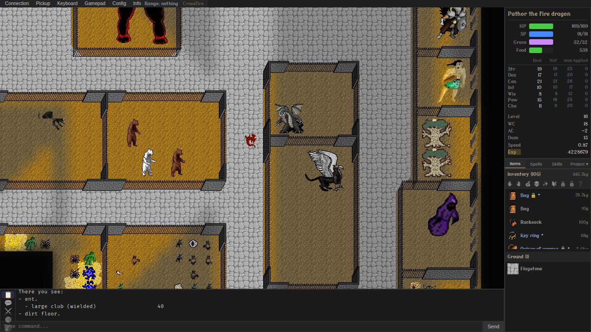

# Crossfire Web Client

A web browser client for [Crossfire](https://crossfire.real-time.com/), the
multiplayer roguelike game. It started as a conversion of the Crossfire
GTK-v2 client to TypeScript and [Svelte](https://svelte.dev/). It runs in
any modern browser, so players don't need to install anything.

Almost everything was done by generative AI, with and me just testing
and prompting.

There is a test server at
[crossfire.diegeekdie.com](https://crossfire.diegeekdie.com/). It is just
for testing and can go down at any time.



## Features

- Map with fog of war, and magic mapping drawn into the unseen parts of
  the map.
- Inventory, spells, skills, hotbar and character sheets.
- Music and sound effects.
- Configurable key bindings, and gamepad support.
- Keyboard and gamepad navigation of the whole user interface.
- Account login and character creation in the client.

See [Differences from the GTK client](#differences-from-the-gtk-client)
for how it differs from the GTK-v2 client.

## Installation

For step-by-step instructions for Debian, Ubuntu and Red Hat/Fedora, see
[INSTALL.md](INSTALL.md).

1. **Patch the server.** Browsers can only use WebSockets, which the
   Crossfire server doesn't support yet. Apply
   [patch #471](https://sourceforge.net/p/crossfire/patches/471/) to the
   server, rebuild it and start it with `-ws-port <port>`, e.g.
   `-ws-port 8080`. The WebSocket port is unencrypted, so don't expose
   it directly.
2. **Install the client.** Download `dist.tar.gz` from the
   [latest release](https://github.com/bofh69/crossfire-web-client/releases/latest)
   and unpack its `dist/` directory into your web root. There is also a
   single-file `index.html` in the release that can be used for other
   URLs.
3. **Install the sounds.** The client loads `sounds/sounds.conf`, the
   sound effects from `sounds/` and the music from `sounds/music/`, all
   relative to `index.html`. `dist.tar.gz` already includes them. With
   the single-file `index.html`, copy
   [crossfire-sounds](https://git.code.sf.net/p/crossfire/crossfire-sounds crossfire-crossfire-sounds)
   into a `sounds/` directory next to it.
4. **Set up a reverse proxy.** Serve the client over HTTPS and forward
   `/ws` to the server's WebSocket port with the `Upgrade` and
   `Connection` headers, and `X-Forwarded-For` so bans still work. When
   the page is served on port 80 or 443, the client connects to
   `ws(s)://<same host>/ws` by itself.

## Usage

Open the page in a browser and log in.

### Connecting to a specific server

Append a `?server=` query parameter to the page URL to connect to a
particular server, e.g.:

```
https://example.com/?server=wss://crossfire.example.com/ws
```

When this parameter is present the server-address input field is hidden and
the "Enter" button is focused, so pressing Enter connects. After connecting,
the client adds the parameter to the URL, so a bookmark or a reload goes back
to the same server.

### Choosing the login method

The client supports both the old login method, where you log in to the
character directly, and the newer one, where you log in to an account and
create characters in the client. The new one is the default. Add
`?loginmethod=0` to the URL to use the old login method.

## Development

See [DEVELOPMENT.md](DEVELOPMENT.md) for how to build and test the client,
run it against a server without WebSocket support, and record and replay
sessions.

## License

The client is licensed under the GNU General Public License, version 2. See
[COPYING](COPYING). The sound files have their own licenses, see
[sounds/COPYING](sounds/COPYING).

## Differences from the GTK client

### Connecting

Web pages can't use raw TCP sockets, so the client connects with
WebSockets. The server must support WebSockets, see
[Installation](#installation).

The client doesn't contact a metaserver.

### Keyboard

A web page can't override all the browser's built in hot keys,
so ALT is used instead of CTRL for running. That way it leads to fewer
conflicts with the browser.

There is a "Keyboard" menu for handling key bindings.

Key bindings are stored locally in the browser. If playing
from different computers/browsers, the bindings will have to
be redone, or the config can be stored to a file and uploaded
to the other server.

Bindings can be stored for all characters or the current logged in one.

A key or gamepad button can run several commands, one after another.
When binding a key/button that is already bound, check "Add after current
commands" in the dialog to add the new command after the existing ones
instead of replacing them. The `bind` and `gamepad_bind` commands take
`-a`/`--append` to pre-check that option, e.g. `bind -a fire`.

### UI navigation mode

Press `Tab` to enter UI navigation mode. In that mode the visible UI can be
navigated with mode-specific keyboard or gamepad controls, `Escape` leaves the
mode. Return selects items/shows menus in the UI navigation mode.

The local command `ui_nav` is used to enter the mode. `ui_nav --stay`
keeps the mode active after running a UI command; by default it exits
automatically after a UI command is sent.

### Mouse

Left clicking on items and skills activates them.

Left clicking on a spell selects/readies it.

Right clicking on items, spells and skills brings up a menu.

### Music & sfx

The client supports music and sfx, they are downloaded
as needed from the web server. Both can be muted.

### Magic mapping

It works somewhat like the DockWindow client,
the map is integrated into the unseen parts of the main map.
Walls are drawn as thin lines.

### Gamepad support

Gamepads that the browser maps to the standard layout (most Xbox,
PlayStation, Switch Pro and Steam controllers) share one set of default
bindings. Other gamepads get a generic profile that can be adjusted with
the "Gamepad" menu.

The left stick walks (runs when pushed far), the right stick fires.
Buttons can be bound to commands from the "Gamepad" menu or with
`gamepad_bind`, and "Show gamepad bindings" lists them.

Holding a button bound to `hotbar` lets the left stick pick a hotbar slot,
which is used when the button is released.

By default the Start/Menu button runs `ui_nav`. In UI navigation mode the
gamepad navigates the UI instead: the left stick or D-pad moves, A
activates, X opens the element's menu, LB/RB move to the previous/next
element and B leaves the mode.
